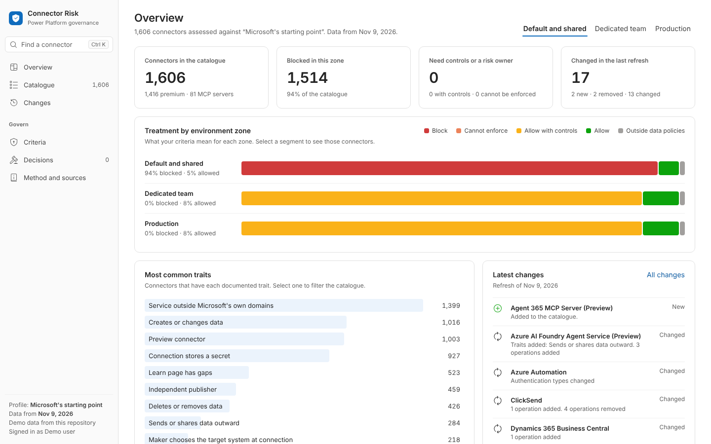
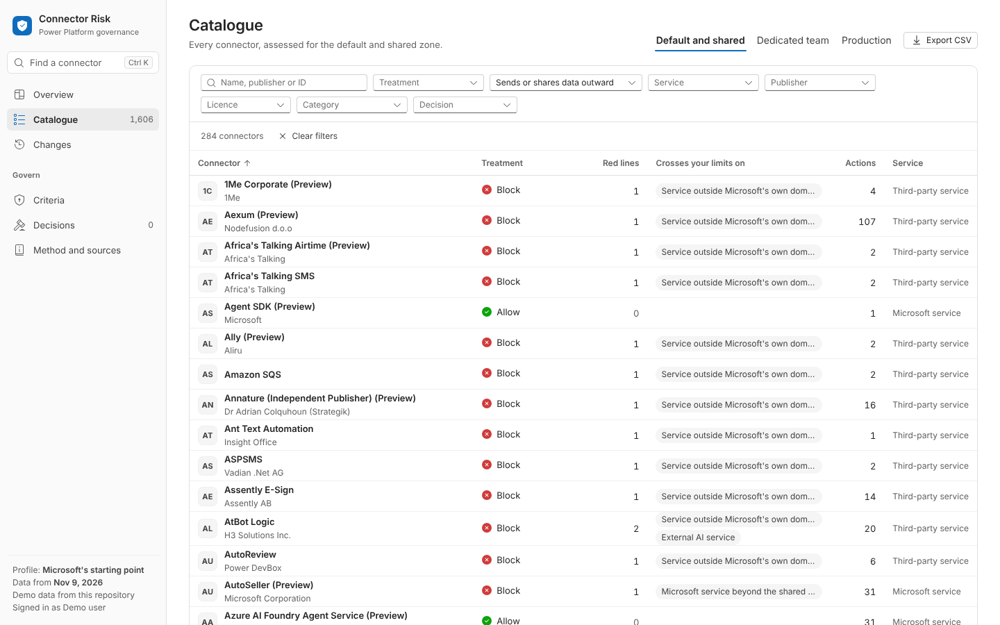
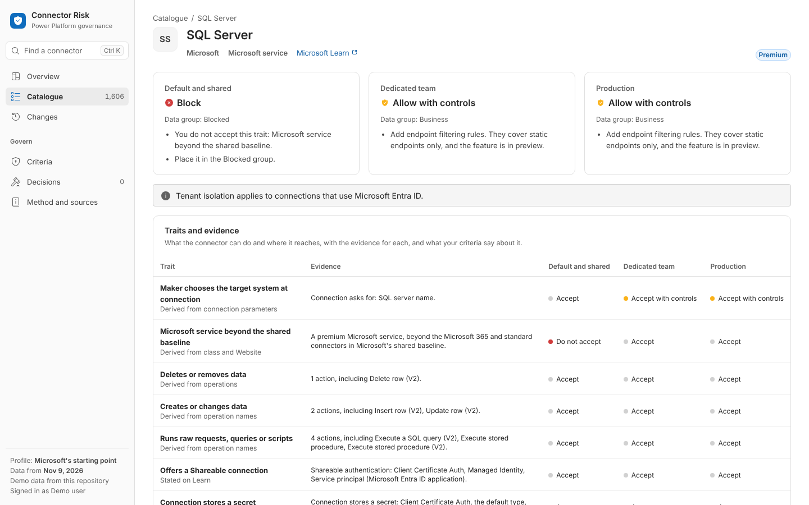
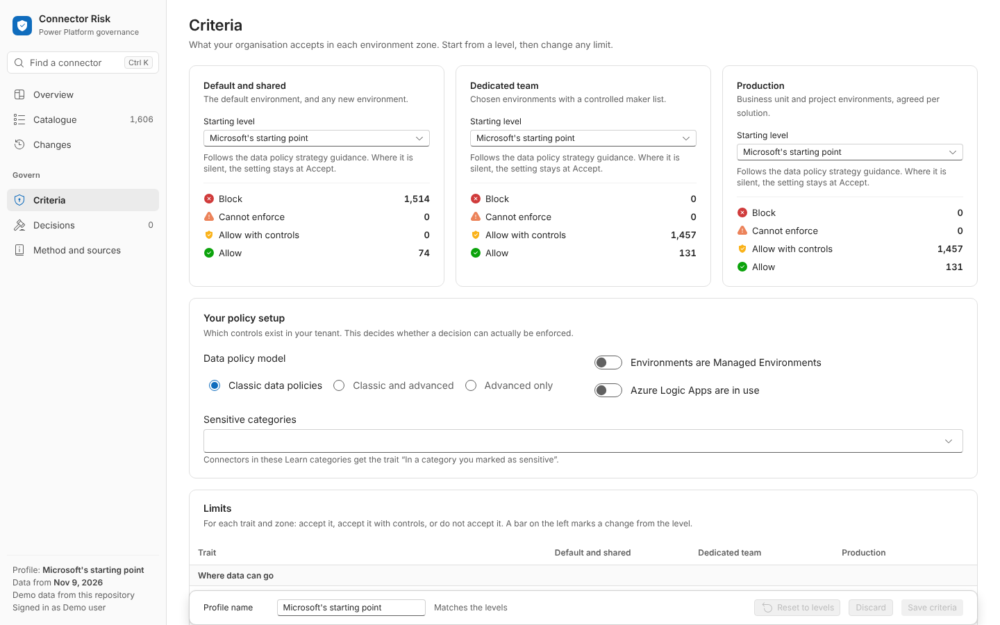
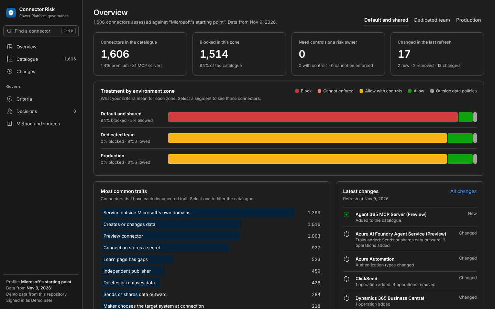

# Connector Risk Framework for Power Platform

The framework inside your own tenant: the weekly connector catalogue in Dataverse, your criteria and
decisions next to it with auditing, and a code app to work with both.



It gives the same answer as the [public site](https://crowdedleopard.github.io/connector-risk-framework/)
for every connector, because it runs the same engine. Like the site, it has no risk score. It shows
what each connector can do, the evidence for it, what your criteria say about it in each environment
zone, and which control can carry that out.

## What is here

| Folder | Contents |
| --- | --- |
| [`dataverse/`](dataverse) | The table design (`schema.mjs`), the single source for provisioning, the app and the docs. |
| [`sync/`](sync) | Provisions the tables and syncs the weekly data with the Dataverse Web API. No dependencies. |
| [`app/`](app) | The Power Apps code app: React, TypeScript and Fluent UI. |
| [`tests/`](tests) | Tests for the sync and the schema. |
| [`docs/`](docs) | [Deployment guide](docs/DEPLOY.md), [architecture](docs/ARCHITECTURE.md) and [data model](docs/DATA-MODEL.md). |
| [`solution/`](solution) | Where exported solution packages go. |

## The app

| Screen | What it is for |
| --- | --- |
| **Overview** | How your criteria play out in each zone, the most common traits, and what the latest refresh changed. |
| **Catalogue** | Every connector with its treatment, filterable by treatment, trait, service, publisher, licence, category and decision. Filters live in the URL, so a view can be shared. Exports to CSV. |
| **Connector** | Why it gets each treatment in each zone, the evidence for every trait, its controls and operations, and your decision. |
| **Changes** | What each weekly refresh added, removed or changed. |
| **Criteria** | What you accept for each trait in each zone, with a live preview of the effect before you save. |
| **Decisions** | The register of connector decisions, with owners and review dates. Overdue reviews come first. |
| **Method and sources** | How it works, how accurate the operation classifier is, and every governance fact with its source. |

Press **Ctrl+K** (or **⌘K**) anywhere to jump to a connector.

| | |
| --- | --- |
|  |  |
|  |  |

## Try it without an environment

Demo mode reads this repository's data files instead of Dataverse, and keeps criteria and decisions in
the browser.

```bash
cd powerplatform/app
npm ci
npm run demo
```

## Deploy it

Follow [docs/DEPLOY.md](docs/DEPLOY.md). In short:

1. Turn on code apps for the environment.
2. Create an app registration and make it a Dataverse application user.
3. `node powerplatform/sync/cli.mjs provision`, then `sync --full`.
4. Configure the **Dataverse sync** workflow so the data stays current every week.
5. Publish the app with `pa app init`, `pa app add data-source` and `pa app push`.

## Develop

```bash
node --test powerplatform/tests/sync.test.mjs   # sync and schema tests
node powerplatform/sync/cli.mjs plan            # what a sync would write, offline
node powerplatform/dataverse/document.mjs       # regenerate DATA-MODEL.md after a schema change

cd powerplatform/app
npm run typecheck && npm run lint && npm test && npm run build
```

The **Power Platform checks** workflow runs all of these on every change under `powerplatform/`.

When you change `schema.mjs`, run provisioning again in each environment: it adds new tables and
columns and leaves existing ones alone. Renaming or removing a column needs a manual change in
Dataverse, because provisioning never deletes.
