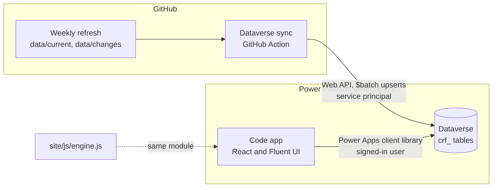

# Architecture

The Power Platform edition gives organisations the framework inside their own tenant: the catalogue
in Dataverse, their own criteria and decisions next to it with auditing, and a code app to work
with both. It adds no new assessment logic. Every treatment comes from the same engine as the
public site, so the two always agree.

## Principles

1. **Facts and judgement stay separate.** Dataverse stores what is documented (connectors,
   operations, traits with evidence) apart from what the organisation decides (criteria in
   `crf_profile`, exceptions in `crf_decision`). Treatments are computed, never stored, so they
   can never go stale against either.
2. **One engine.** The app imports `site/js/engine.js` unchanged through a Vite alias. A test runs
   every connector through Dataverse's row shape and back, and checks that each one gets the same
   treatment in every zone as when read straight from `index.json`.
3. **No risk score.** The framework deliberately has none, and neither do the tables or the app.
4. **Repeatable and idempotent.** Provisioning only adds what is missing. Every row has a
   deterministic ID (a UUID version 5 from its natural key), so a sync is a set of upserts that can
   be run any number of times with the same result, and needs no lookups to find existing rows.
5. **The repository is the source of truth for the catalogue; Dataverse is the source of truth for
   decisions.** The sync never writes to `crf_profile` (beyond seeding one default) or
   `crf_decision`.

## The sync

`powerplatform/sync` is plain Node.js 22 with no dependencies.

| Module | Responsibility |
| --- | --- |
| `cli.mjs` | Entry point: `provision`, `sync [--full]`, `plan`. Reads settings from environment variables only. |
| `auth.mjs` | Client credentials sign-in, with a client secret or a GitHub OIDC federated credential. |
| `dataverse.mjs` | A small Web API client: retries on 429, 502 and 503 honouring `Retry-After`, follows paging, and sends `$batch` requests of 200 with a bounded number in flight. |
| `provision.mjs` | Creates the publisher, solution, choices, tables, lookups and alternate keys from `schema.mjs`, then publishes. |
| `mapping.mjs` | Pure functions from repository data to Dataverse rows. |
| `sync.mjs` | The order of work, below. |
| `describe.mjs` | Describes a change in words. Shared with the app's demo mode. |

A sync:

1. Upserts trait definitions and governance facts.
2. Reads the connectors already in Dataverse with their `crf_lastchanged` dates.
3. Upserts every connector. Connectors no longer in the catalogue are flagged
   `crf_isremoved`, not deleted, so decisions and history keep their link.
4. For connectors that are new or whose data changed (or all of them with `--full`), upserts their
   traits and operations and deletes child rows that no longer exist.
5. Upserts the change log and a `crf_refresh` row recording counts, the classifier's agreement
   rate and the commit.
6. Seeds a default risk profile if the environment has none.

A weekly sync usually rewrites a few dozen connectors. Requests that Dataverse rejects are
listed in the output; more than 25 fail the job.

## The code app

`powerplatform/app` is React 19, TypeScript in strict mode and Fluent UI 9, built with Vite.

| Folder | Responsibility |
| --- | --- |
| `src/data` | The `Repository` interface and two implementations: `DataverseRepository` (the Power Apps client library) and `StaticRepository` (the repository's JSON files, for demo mode and screenshots). Both lazy-load, so each build contains only what it uses. |
| `src/state` | One provider that loads the catalogue, profile and decisions, and derives results for every zone with `useMemo`. Evaluating 1,600 connectors takes about 10 ms. |
| `src/views` | One file per screen: overview, catalogue, connector, changes, criteria, decisions, method. |
| `src/components` | The shell (sidebar and command palette) and small presentational parts. |
| `src/theme` | Fluent light and dark themes and the layout CSS, written against Fluent's design tokens so both themes come from one stylesheet. |

Design choices:

- **Dense and calm**, after Linear, Vercel and the Fluent 2 web guidance: 13px base text, 44px
  rows, one accent colour, colour reserved for status.
- **Treatments always carry an icon and a label**, never colour alone. The five treatment colours
  are fixed per treatment in every view and chart.
- **Hash routing**, because the Power Apps host owns the page path. Filters live in the URL, so a
  filtered catalogue can be bookmarked and shared.
- **Ctrl+K or ⌘K** opens a palette that jumps to any connector.
- **Incremental rendering** of the catalogue keeps the first paint fast without a virtualisation
  library.
- **Light and dark** follow the operating system.

## Security

- The sync's service principal needs create, read, write and delete on the `crf_` tables only once
  provisioning is done. Prefer a federated credential, which leaves no secret to store or rotate.
- The app runs as the signed-in user, so Dataverse security roles decide who can read the catalogue
  and who can change criteria or record decisions. Dataverse enforces this: a save without the
  privilege fails and the app shows Dataverse's message.
- Every table has auditing turned on. Auditing must also be on for the environment, in the admin
  center under **Settings** > **Audit and logs**. Decisions are user-owned, so each has an accountable owner.
- CSV exports neutralise values that a spreadsheet would treat as formulas.

## Testing

| Test | What it proves |
| --- | --- |
| `powerplatform/tests/sync.test.mjs` | Mapping, batching, retries, the incremental sync against a fake Dataverse, schema rules, and that `DATA-MODEL.md` matches the schema. |
| `powerplatform/app/tests/roundtrip.test.ts` | Every connector survives the trip through Dataverse's row shape, and gets the same treatment in every zone. |
| Type check, lint, two builds | Run by the **Power Platform checks** workflow on every change under `powerplatform/`. |
