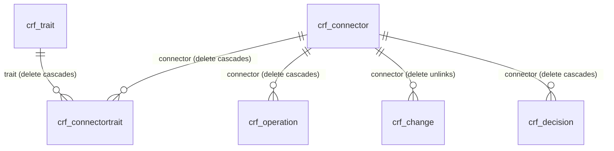

# Data model

<!-- Generated by powerplatform/dataverse/document.mjs from schema.mjs. Do not edit by hand. -->

All tables belong to the solution `ConnectorRiskFramework` (version 1.0.0.0), published by `connectorriskframework` with the prefix `crf`.
Provisioning creates everything below and is safe to run again: it adds what is missing and leaves the rest alone.

There is deliberately no risk score column. The app stores facts, traits, the organisation's criteria and its decisions, and derives each treatment at run time with the same engine as the public site.

## Relationships

## Tables

### Connector (`crf_connector`)

A Power Platform connector, with the documented facts and derived traits from the weekly refresh.

Entity set `crf_connectors`. Owned by the organisation. Auditing is on.
Alternate key: `crf_connector_slug` on `crf_slug`.

| Column | Label | Type |
| --- | --- | --- |
| `crf_name` | Name | Primary name, text (200) |
| `crf_slug` | Slug | Text (100), required |
| `crf_apiid` | API ID | Text (200) |
| `crf_kind` | Kind | Text (100) |
| `crf_publishername` | Publisher | Text (200) |
| `crf_publishertype` | Publisher type | Choice (`crf_publishertype`) |
| `crf_origin` | Service origin | Choice (`crf_origin`) |
| `crf_originevidence` | Origin evidence | Multiline text (2,000) |
| `crf_premium` | Premium | Yes/no |
| `crf_preview` | Preview | Yes/no |
| `crf_deprecated` | Deprecated | Yes/no |
| `crf_mcp` | MCP server | Yes/no |
| `crf_hasdefinition` | Has published definition | Yes/no |
| `crf_isremoved` | Removed from catalogue | Yes/no |
| `crf_liveactions` | Live actions | Whole number |
| `crf_triggers` | Triggers | Whole number |
| `crf_readactions` | Read actions | Whole number |
| `crf_writeactions` | Write actions | Whole number |
| `crf_deleteactions` | Delete actions | Whole number |
| `crf_sendactions` | Send actions | Whole number |
| `crf_rawactions` | Raw request actions | Whole number |
| `crf_adminactions` | Administration actions | Whole number |
| `crf_otheractions` | Unclassified actions | Whole number |
| `crf_classifiable` | Classifiable by data policies | Yes/no |
| `crf_datapolicy` | Governed by data policies | Yes/no |
| `crf_blockable` | Blockable | Yes/no |
| `crf_nonblockable` | On the nonblockable list | Yes/no |
| `crf_actioncontrol` | Supports action control | Yes/no |
| `crf_endpointfiltering` | Supports endpoint filtering | Yes/no |
| `crf_logicapps` | Available in Logic Apps | Yes/no |
| `crf_acpsupport` | Advanced connector policy support | Choice (`crf_acpsupport`) |
| `crf_tenantisolation` | Tenant isolation | Choice (`crf_tenantisolation`) |
| `crf_traitkeys` | Trait keys | Text (1,000) |
| `crf_categories` | Categories on Learn | Text (1,000) |
| `crf_products` | Works in | Text (500) |
| `crf_authtypes` | Authentication types | Multiline text (4,000) |
| `crf_servicedomain` | Service domain | Text (200) |
| `crf_learnurl` | Learn page | URL |
| `crf_website` | Website | URL |
| `crf_privacypolicy` | Privacy policy | URL |
| `crf_firstseen` | First seen | Date only |
| `crf_lastchanged` | Last changed | Date only |
| `crf_datadate` | Data date | Date only |

### Trait (`crf_trait`)

A documented exposure a connector can have, such as sending data outward. Mirrors EXPOSURES in site/js/engine.js.

Entity set `crf_traits`. Owned by the organisation. Auditing is on.
Alternate key: `crf_trait_key` on `crf_key`.

| Column | Label | Type |
| --- | --- | --- |
| `crf_name` | Name | Primary name, text (200) |
| `crf_key` | Key | Text (100), required |
| `crf_group` | Group | Choice (`crf_traitgroup`) |
| `crf_scope` | Control scope | Choice (`crf_traitscope`) |
| `crf_help` | Explanation | Multiline text (2,000) |
| `crf_basis` | How we know | Text (200) |
| `crf_sortorder` | Sort order | Whole number |

### Connector trait (`crf_connectortrait`)

One trait on one connector, with the evidence for it.

Entity set `crf_connectortraits`. Owned by the organisation. Auditing is on.

| Column | Label | Type |
| --- | --- | --- |
| `crf_name` | Name | Primary name, text (200) |
| `crf_evidence` | Evidence | Multiline text (4,000) |
| `crf_connector` | Connector | Lookup to `crf_connector` |
| `crf_trait` | Trait | Lookup to `crf_trait` |

### Operation (`crf_operation`)

An action or trigger on a connector, with the class the open classification rules gave it.

Entity set `crf_operations`. Owned by the organisation. Auditing is on.

| Column | Label | Type |
| --- | --- | --- |
| `crf_name` | Name | Primary name, text (300) |
| `crf_apioperationid` | Operation ID | Text (300) |
| `crf_kind` | Kind | Choice (`crf_operationkind`) |
| `crf_class` | Class | Choice (`crf_operationclass`) |
| `crf_basis` | Classified by | Text (200) |
| `crf_method` | HTTP method | Text (20) |
| `crf_isdeprecated` | Deprecated | Yes/no |
| `crf_parametercount` | Parameters | Whole number |
| `crf_anchor` | Learn anchor | Text (400) |
| `crf_connector` | Connector | Lookup to `crf_connector` |

### Governance fact (`crf_fact`)

A claim about Microsoft behaviour, checked against its source page on every refresh.

Entity set `crf_facts`. Owned by the organisation. Auditing is on.

| Column | Label | Type |
| --- | --- | --- |
| `crf_name` | ID | Primary name, text (100) |
| `crf_statement` | Statement | Multiline text (2,000) |
| `crf_status` | Status | Text (50) |
| `crf_source` | Source | Text (100) |
| `crf_sourceurl` | Source page | URL |
| `crf_missing` | Missing evidence | Multiline text (2,000) |
| `crf_lastchecked` | Last checked | Date only |

### Catalogue change (`crf_change`)

A connector that was added, removed or changed in a weekly refresh.

Entity set `crf_changes`. Owned by the organisation. Auditing is on.

| Column | Label | Type |
| --- | --- | --- |
| `crf_name` | Name | Primary name, text (300) |
| `crf_slug` | Slug | Text (100) |
| `crf_changedate` | Change date | Date only |
| `crf_changetype` | Change type | Choice (`crf_changetype`) |
| `crf_summary` | Summary | Multiline text (4,000) |
| `crf_detailjson` | Detail (JSON) | Multiline text (100,000) |
| `crf_connector` | Connector | Lookup to `crf_connector` |

### Data refresh (`crf_refresh`)

One weekly snapshot of the catalogue, for trends over time.

Entity set `crf_refreshes`. Owned by the organisation. Auditing is on.

| Column | Label | Type |
| --- | --- | --- |
| `crf_name` | Name | Primary name, text (100) |
| `crf_datadate` | Data date | Date only |
| `crf_connectorcount` | Connectors | Whole number |
| `crf_operationcount` | Operations | Whole number |
| `crf_premiumcount` | Premium | Whole number |
| `crf_previewcount` | Preview | Whole number |
| `crf_mcpcount` | MCP servers | Whole number |
| `crf_independentcount` | Independent publishers | Whole number |
| `crf_microsoftcount` | Microsoft published | Whole number |
| `crf_nonblockablecount` | Nonblockable | Whole number |
| `crf_newcount` | New this week | Whole number |
| `crf_removedcount` | Removed this week | Whole number |
| `crf_changedcount` | Changed this week | Whole number |
| `crf_classifieragree` | Classifier agreements | Whole number |
| `crf_classifiercomparable` | Classifier comparisons | Whole number |
| `crf_commit` | Source commit | Text (100) |
| `crf_metajson` | Metadata (JSON) | Multiline text (100,000) |

### Risk profile (`crf_profile`)

The organisation's criteria: what it accepts in each environment zone. Settings use the engine.js settings shape.

Entity set `crf_profiles`. Owned by the organisation. Auditing is on.

| Column | Label | Type |
| --- | --- | --- |
| `crf_name` | Name | Primary name, text (200) |
| `crf_description` | Description | Multiline text (2,000) |
| `crf_isdefault` | Default profile | Yes/no |
| `crf_settingsjson` | Settings (JSON) | Multiline text (100,000) |

### Connector decision (`crf_decision`)

The organisation's own decision on a connector, which overrides the criteria. The record owner is the decision owner.

Entity set `crf_decisions`. Owned by a user or team, so the owner is accountable for the record. Auditing is on.

| Column | Label | Type |
| --- | --- | --- |
| `crf_name` | Name | Primary name, text (200) |
| `crf_decision` | Decision | Choice (`crf_decisiontype`) |
| `crf_rationale` | Rationale | Multiline text (4,000) |
| `crf_reference` | Reference | Text (200) |
| `crf_reviewdate` | Review by | Date only |
| `crf_connector` | Connector | Lookup to `crf_connector` |

## Choices

Global choices, so every table and any report shares one set of values. Each option's key is the string the repository's data files use.

### Service origin (`crf_origin`)

| Value | Key | Label |
| --- | --- | --- |
| 419300000 | `microsoft` | Microsoft service |
| 419300001 | `third-party` | Third-party service |
| 419300002 | `maker-defined` | Destination set by maker |
| 419300003 | `unstated` | Not stated on Learn |

### Publisher type (`crf_publishertype`)

| Value | Key | Label |
| --- | --- | --- |
| 419300000 | `microsoft` | Microsoft |
| 419300001 | `independent` | Independent publisher |
| 419300002 | `other` | Other publisher |

### Advanced connector policy support (`crf_acpsupport`)

| Value | Key | Label |
| --- | --- | --- |
| 419300000 | `supported` | Supported |
| 419300001 | `unsupported` | Not supported |
| 419300002 | `unconfirmed` | Unconfirmed |
| 419300003 | `not-applicable` | Not applicable |

### Tenant isolation (`crf_tenantisolation`)

| Value | Key | Label |
| --- | --- | --- |
| 419300000 | `applies` | Applies |
| 419300001 | `gap` | Known gap |
| 419300002 | `not-shown` | Not shown on Learn |

### Operation kind (`crf_operationkind`)

| Value | Key | Label |
| --- | --- | --- |
| 419300000 | `action` | Action |
| 419300001 | `trigger` | Trigger |

### Operation class (`crf_operationclass`)

| Value | Key | Label |
| --- | --- | --- |
| 419300000 | `read` | Reads data |
| 419300001 | `write` | Creates or changes data |
| 419300002 | `delete` | Deletes or removes data |
| 419300003 | `send` | Sends or shares data outward |
| 419300004 | `raw` | Runs raw requests, queries or scripts |
| 419300005 | `admin` | Administers platform, identity or access |
| 419300006 | `other` | Not classified |

### Trait group (`crf_traitgroup`)

| Value | Key | Label |
| --- | --- | --- |
| 419300000 | `destination` | Where data can go |
| 419300001 | `capability` | What it can do |
| 419300002 | `identity` | Whose identity and credentials |
| 419300003 | `maintenance` | Who maintains it |
| 419300004 | `data` | What your data needs |

### Control scope (`crf_traitscope`)

| Value | Key | Label |
| --- | --- | --- |
| 419300000 | `action` | Individual actions |
| 419300001 | `endpoint` | Destination endpoint |
| 419300002 | `connector` | Whole connector |

### Change type (`crf_changetype`)

| Value | Key | Label |
| --- | --- | --- |
| 419300000 | `new` | New connector |
| 419300001 | `removed` | Removed connector |
| 419300002 | `changed` | Changed connector |

### Connector decision (`crf_decisiontype`)

| Value | Key | Label |
| --- | --- | --- |
| 419300000 | `approved` | Approved: agreement in place |
| 419300001 | `allow` | Always allow |
| 419300002 | `block` | Always block |
